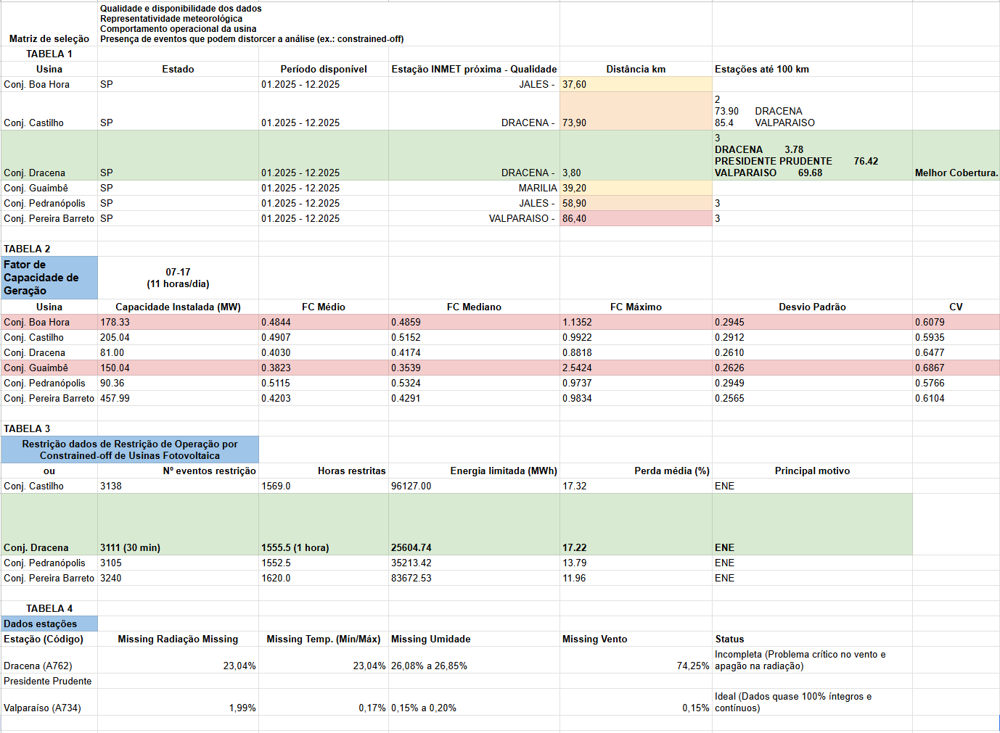

# Análises Exploratórias

Esta pasta reúne análises realizadas durante as etapas iniciais do TCC para investigar a disponibilidade e a qualidade dos dados, selecionar a usina fotovoltaica utilizada no estudo e avaliar possíveis variáveis e fontes de dados.

Essas análises tiveram caráter exploratório e auxiliaram na definição do escopo final do trabalho. Nem todas as variáveis ou abordagens investigadas nesta etapa foram mantidas no pipeline final de modelagem.

## Visão geral das análises

A exploração inicial considerou principalmente três aspectos:

### 1. Seleção da usina e disponibilidade de dados meteorológicos

Foram analisadas diferentes usinas fotovoltaicas do estado de São Paulo considerando a disponibilidade de dados de geração e a proximidade de estações meteorológicas do INMET.

Entre as usinas avaliadas, o **Conjunto Fotovoltaico Dracena** apresentou condições adequadas para continuidade do estudo, incluindo disponibilidade de dados de geração durante o período analisado e proximidade de estações meteorológicas.

Também foram avaliadas estações meteorológicas localizadas em um raio de até aproximadamente 100 km, incluindo Dracena, Presidente Prudente e Valparaíso.

### 2. Análise do fator de capacidade

Foi realizada uma análise exploratória do fator de capacidade das usinas fotovoltaicas consideradas inicialmente.

Foram calculadas estatísticas como:

- fator de capacidade médio;
- mediana;
- valor máximo;
- desvio padrão;
- coeficiente de variação.

A análise foi utilizada inicialmente para investigar o comportamento operacional das usinas e auxiliar na seleção do objeto de estudo.

Posteriormente, o fator de capacidade não foi mantido como variável principal do pipeline final, uma vez que o trabalho passou a utilizar diretamente a série temporal de geração fotovoltaica.

**Notebook:** `EXP_01_capacity_factor_station_distance.ipynb`

---

### 3. Qualidade dos dados meteorológicos

Foi analisada a qualidade dos dados meteorológicos disponíveis nas estações próximas à usina de Dracena.

A análise considerou principalmente a presença de valores ausentes nas variáveis:

- temperatura;
- umidade relativa;
- velocidade do vento;
- radiação solar;
- pressão atmosférica.

A estação de Dracena apresentou lacunas relevantes em algumas variáveis, especialmente vento e radiação. Por esse motivo, outras fontes e estações meteorológicas foram posteriormente utilizadas durante a construção do dataset.

A estação de Valparaíso apresentou elevada disponibilidade de dados e foi considerada como fonte auxiliar em etapas posteriores do pré-processamento.

**Notebook:** `EXP_02_meteorological_data_quality.ipynb`

---

### 4. Análise de Constrained-off

Também foi investigada a ocorrência de restrições de operação por **Constrained-off** nas usinas fotovoltaicas consideradas.

Foram analisados aspectos como:

- número de eventos de restrição;
- quantidade de horas restritas;
- energia limitada;
- perda percentual;
- principal motivo das restrições.

Essa análise foi realizada para verificar se as restrições operacionais deveriam ser incorporadas ao problema de previsão.

Após a exploração inicial e a definição do escopo do trabalho, os dados de constrained-off não foram incorporados como variável do dataset final utilizado na modelagem.

**Notebook:** `EXP_03_constrained_off_analysis.ipynb`

---

## Resultado da etapa exploratória

As análises desta pasta contribuíram para a definição do escopo utilizado nas etapas seguintes do projeto.

O estudo passou a concentrar-se no **Conjunto Fotovoltaico Dracena**
